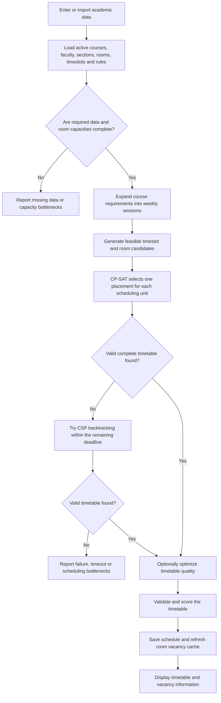

# Smart Department Timetable, Classroom Allotment and Real-Time Vacancy System

An academic scheduling web application for generating department timetables and assigning classrooms. It schedules weekly course sessions against faculty, section, room, timeslot and department constraints. The system also provides timetable views, coordinator editing tools and a room-vacancy dashboard with WebSocket updates.

## Project at a Glance

- **Primary scheduler:** Google OR-Tools CP-SAT
- **Fallback scheduler:** CSP backtracking solver with bitmask occupancy, MRV ordering and forward checking
- **Scheduling rules:** 22 modular constraints, with selected rules configurable by the active constraint profile
- **Timetable quality:** 7 weighted soft-constraint measures on a 0–100 scale
- **Web application:** React frontend and FastAPI backend
- **Storage:** SQLite for local use; MySQL can be configured for deployment
- **Live vacancy:** In-memory occupancy cache and WebSocket broadcasts

## Features

- Generate a timetable for a selected semester or the full department.
- Assign timeslots and compatible classrooms while scheduling course sessions.
- Manage faculty, sections, courses, rooms, timeslots, availability, reservations and elective groups.
- Import CSV and Excel data through templates; import supported coordinator teaching-load workbooks.
- View timetables by section, teacher or room, and print timetable views.
- Search timetable entities. In Teacher View, entries whose employee ID begins with `FACULTY_` are hidden from the selector. This only filters the displayed options; it does not delete or modify teacher records.
- Let authorized coordinators preview timetable changes against constraints before saving them.
- View room vacancy cards with filters and search; changes to a saved schedule refresh the vacancy information.
- Review the constraint profile and generation status, including hard violations, quality score and runtime.

## Project Report

### 1. Title of the Project

**Smart Department Timetable, Classroom Allotment and Real-Time Vacancy System**

### 2. Objectives

- Automate timetable generation from course, faculty, section, room and timeslot data.
- Avoid conflicting assignments for teachers, student sections and rooms.
- Match classrooms to course room types and required capacities.
- Respect weekly teaching loads, faculty availability, reserved periods and multi-period lab sessions.
- Improve timetable quality by distributing classes through the week and reducing idle gaps where possible.
- Provide timetable views and up-to-date room vacancy information for users and coordinators.

### 3. Algorithm / Flowchart / Block Diagram

The system first attempts to find a feasible timetable with OR-Tools CP-SAT. If CP-SAT does not produce a valid schedule within the configured deadline, the service tries the CSP backtracking solver with the time remaining. Once a feasible timetable exists, optional optimization can improve weekly balance and lab-day grouping without violating hard constraints.



### 4. Methodology

1. **Prepare the input data:** Enter or import faculty, sections, courses, rooms, timeslots, availability and reserved periods.
2. **Validate readiness:** Check that course assignments, section strengths and room capacities needed for scheduling are available. Report incomplete or infeasible inputs before solving.
3. **Expand course demand:** Convert each course's weekly requirements into individual sessions, including multi-period labs, paired batches and linked elective sessions.
4. **Generate feasible candidates:** Remove placements that violate availability, room type or capacity requirements, reserved periods, recess periods or contiguous-session rules.
5. **Solve the constraint model:** Use CP-SAT to select placements while enforcing resource conflicts and department rules. Use CSP backtracking as a fallback within the remaining time limit.
6. **Optimize and validate:** When enabled, improve weekly balance or lab-day grouping. Validate the complete schedule against the active constraints and compute its soft score.
7. **Save and display:** Persist valid sessions and generation details, update the vacancy cache, and display the timetable in the web interface.

The project defines 22 modular constraints. Examples include no teacher, section or room double-booking; room capacity and room-type checks; weekly session counts; contiguous labs; teacher availability; reserved and recess periods; daily and consecutive-period limits; section gaps; first-class start times; synchronized program electives; and avoiding repeated lectures for a course on the same day. Some rules or thresholds can be configured in the active constraint profile.

The soft score uses seven weighted measures: section idle gaps, teacher idle gaps, course spread across days, heavy daily stacking, daily workload balance, room locality and number of rooms used. The score is normalized to a 0–100 scale; higher scores indicate fewer soft-constraint penalties.

### 5. Results

The latest schedule currently stored in the project's local database is marked **VALID**. That saved schedule contains **237 timetable session records** across **15 sections**, covering **119 distinct courses** and **23 rooms** from Monday through Saturday. It was generated with Google OR-Tools CP-SAT in approximately **62.1 seconds**, with **0 hard-constraint violations** and a soft-constraint score of **84.4/100**.

These figures describe the database snapshot available when this README was updated. They can change when input data or scheduling settings change and the timetable is regenerated.

### 6. Conclusion

The project automates timetable creation and classroom allocation while checking department rules and preventing scheduling conflicts. Its administrative pages support data management and imports, while timetable views and coordinator editing tools make schedules easier to review and maintain. The vacancy dashboard presents room availability derived from the saved timetable and refreshes when schedule changes are saved.

### 7. Future Scope

- Connect room sensors, RFID or check-in systems to show actual room occupancy in addition to schedule-based vacancy.
- Add mobile-friendly notifications for timetable changes and room updates.
- Expand timetable exports, including downloadable PDF and spreadsheet formats.
- Add more faculty and student preference options to the timetable optimizer.
- Extend the system to support multiple departments or institutions with separate configurations.

## Architecture

```text
React + Vite
    ├── REST API requests ───────────┐
    └── Vacancy WebSocket connection │
                                     ▼
                                  FastAPI
    ├── Timetable, data import and coordinator APIs
    ├── OR-Tools CP-SAT scheduler
    ├── CSP backtracking fallback
    ├── 22 modular constraint checks and soft scorer
    └── Vacancy cache + WebSocket manager
                                     │
                                     ▼
                         SQLite (local) / MySQL
```

## Technology Stack

- **Backend:** Python 3.11+, FastAPI, SQLAlchemy 2.x, Alembic, Pydantic v2
- **Scheduling:** Google OR-Tools CP-SAT; custom CSP backtracking fallback
- **Frontend:** React, Vite, React Router, Axios, Recharts
- **Database:** SQLite by default; MySQL can be configured for deployment
- **Real-time updates:** FastAPI WebSocket
- **Automated checks:** pytest

## Setup and Run

### Prerequisites

- Python 3.11 or newer
- Node.js 20.19 or newer, or 22.12 or newer
- MySQL 8.0 or newer only if using MySQL instead of the default local SQLite database

### 1. Install backend dependencies

From the project root:

```bash
cd backend
python -m pip install -r requirements.txt
cd ..
```

The default local database is `backend/smart_timetable.db`; a local MySQL service is not required. To use MySQL for deployment, configure `DATABASE_URL` in `backend/.env`.

### 2. Load data

To seed the verified CSE reference structure:

```bash
python scripts/seed_database.py
```

The seed creates the A1–A9 section structure and assigns courses only to A2, A3, A5, A7 and A9 because those sections are present in the supplied workbook. Section strengths and room capacities remain unset until verified departmental values are entered.

For a fictional test dataset, use:

```bash
python scripts/seed_demo_data.py
```

The demo seed replaces the current local data with fictional CSE-V data: 9 sections, 30 faculty, 16 rooms, 48 timeslots and 144 session records. It includes paired lab batches, lunch reservations, fixed MDM periods and faculty availability. Replace it with official data before using the generated timetable for departmental operations.

### 3. Start the backend

```bash
cd backend
uvicorn app.main:app --reload --port 8000
```

### 4. Start the frontend

In a second terminal:

```bash
cd frontend
npm install
npm run dev:isolated
```

### 5. Open the application

- Frontend: <http://localhost:5174>
- API documentation: <http://localhost:8000/docs>
- Vacancy WebSocket: `ws://localhost:8000/ws/vacancy`

## Importing Department Data

The Faculty, Sections, Courses, Rooms and Timeslots pages provide CSV templates and CSV/Excel import controls. The importer validates a file before saving and updates matching records instead of creating duplicates. A typical import order is:

1. Faculty, Sections, Rooms and Timeslots
2. Courses, using section names and faculty `employee_id` values from the earlier imports

For course imports, `credits` represents the number of required sessions per week. Add recess and lunch periods through Reserved Slots so they appear in section timetables.

The Courses page also supports the department's three-sheet coordinator teaching-load workbook. It reads:

- `2026-27` for course codes, names and weekly lecture/practical hours
- `FINAL_FacultyWise` for the faculty roster and declared loads
- `FINAL_Subject wise` for semester/section counts and faculty-to-section assignments

The workbook import creates only faculty and course assignments explicitly mapped in the source and preserves existing verified section strengths and faculty contact details. Student strengths, room capacities, timeslots, faculty availability and complete lab-batch mappings must be supplied separately when they are not present in the workbook.

## Constraint Reference

All rules are implemented as separate modules. Whether a rule is active or treated as hard or soft depends on its configuration and the active constraint profile.

| Code | Rule |
|---|---|
| C01 | Prevent a teacher from being scheduled in overlapping sessions |
| C02 | Prevent a section from being scheduled in overlapping sessions |
| C03 | Prevent a room from being assigned to overlapping sessions |
| C04 | Require sufficient room capacity for the section or cohort |
| C05 | Match room type to course requirements |
| C06 | Meet required weekly session counts |
| C07 | Keep multi-period sessions contiguous |
| C08 | Respect teacher availability |
| C09 | Block reserved timeslots |
| C10 | Limit lecture periods per day |
| C11 | Limit consecutive periods |
| C12 | Limit section teaching hours per day |
| C13 | Respect recess periods and windows |
| C14 | Respect visiting faculty availability |
| C15 | Apply senior faculty preferences according to configured mode |
| C16 | Use rooms from the active room inventory |
| C17 | Limit teacher teaching hours per day |
| C18 | Respect configured honours reservations |
| C19 | Avoid unregistered or overly long gaps in a section's day |
| C20 | Require a section's first class to start by its configured latest start time |
| C21 | Synchronize linked program elective sessions across sections |
| C22 | Avoid scheduling repeat lectures for the same course and section on one day |

## Run Tests and Benchmark

Run the backend test suite from the backend directory:

```bash
cd backend
python -m pytest -v
```

Run the synthetic scheduler benchmark from the project root:

```bash
python scripts/benchmark_scheduler.py
```

## Troubleshooting

- **Database connection fails:** For local development, confirm the SQLite database is available. For MySQL, check the `DATABASE_URL` value and that the service is running.
- **Backend import errors:** Install dependencies from the `backend` directory with `python -m pip install -r requirements.txt`.
- **Frontend cannot reach the API:** Confirm the backend is running on port 8000 and check the configured CORS origins.
- **Scheduler times out:** Review the active dataset and constraint profile, or increase `SCHEDULER_TIMEOUT_SECONDS` in the environment configuration.
- **No valid timetable is found:** Check for missing course assignments, unset section strengths, room capacities, insufficient rooms or incompatible faculty availability.
- **Old timetable appears:** Refresh the frontend and confirm that a recent valid schedule was generated. The timetable view displays the latest valid schedule.
